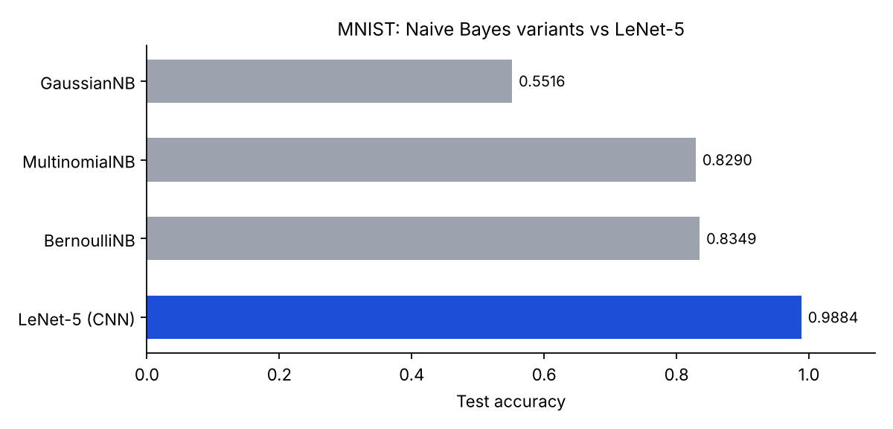
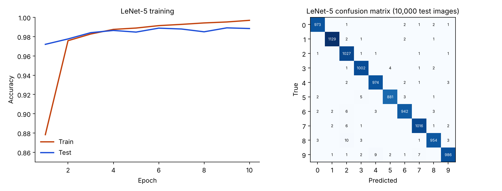

# MNIST: LeNet-5 and Naive Bayes

Two ways to classify handwritten digits: a LeNet-5 convolutional network in PyTorch (98.84% test accuracy) and three scikit-learn Naive Bayes classifiers (55.2% to 83.5%).



| Model | Input | Test accuracy |
|---|---|---|
| **LeNet-5** (tanh, average pooling) | 32x32 padded, scaled to 0-1 | **0.9884** |
| BernoulliNB | binarised (pixel > 0) | 0.8349 |
| MultinomialNB | raw pixel values 0-255 | 0.8290 |
| GaussianNB | pixels scaled to 0-1 | 0.5516 |



## LeNet-5

- Architecture: conv(1, 6, 5), avg-pool, conv(6, 16, 5), avg-pool, FC 400-120-84-10, tanh activations. 28x28 images are padded to 32x32.
- Training: SGD, lr 0.05, momentum 0.9, batch 128, 10 epochs, seed 0, official 60,000 / 10,000 split. Final train accuracy 99.79%, test 98.84%.
- A sanity check hashed every image and found **0 identical images** shared between train and test.
- Weakest classes: 9 (97.7%) and 8 (98.0%). The most common confusions are 9 mistaken for 4 (9 times) and 8 mistaken for 2 (10 times).

## Naive Bayes

- Data: all 70,000 MNIST images from OpenML, random 80/20 split (seed 42): 56,000 train, 14,000 test.
- GaussianNB does worst because most pixels are exactly 0, so per-pixel Gaussians are a poor fit. Treating pixels as binary (Bernoulli) or as counts (Multinomial) is much better.

## Caveats

- The two experiments use **different splits** (official 60k/10k for LeNet-5, a random 80/20 split of all 70k for Naive Bayes), so the comparison is indicative, not a controlled benchmark.
- LeNet-5 test accuracy was printed every epoch but no epoch was selected from it; the reported number is the last epoch (0.9884). The best epoch was 9 (0.9891).
- Single run per model; no confidence intervals.

## Run it

```bash
python src/lenet5.py         # needs mnist_train.csv and mnist_test.csv in the working directory
python src/naive_bayes.py    # downloads MNIST from OpenML
python make_chart.py         # rebuilds the charts from results/
```

## Files

| File | Purpose |
|---|---|
| `src/lenet5.py` | CSV dataset, LeNet-5 model, training loop |
| `src/naive_bayes.py` | Three Naive Bayes models, confusion matrix, report |
| `results/` | Training log, confusion matrix, Naive Bayes accuracies |
| `make_chart.py` | Builds the charts |

## Stack

`Python` `PyTorch` `scikit-learn` `NumPy` `matplotlib`
